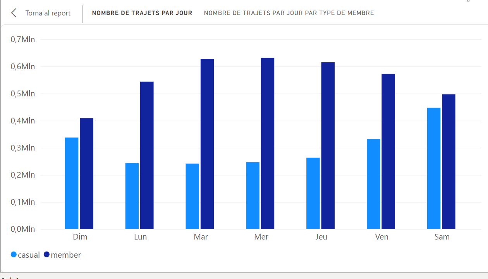
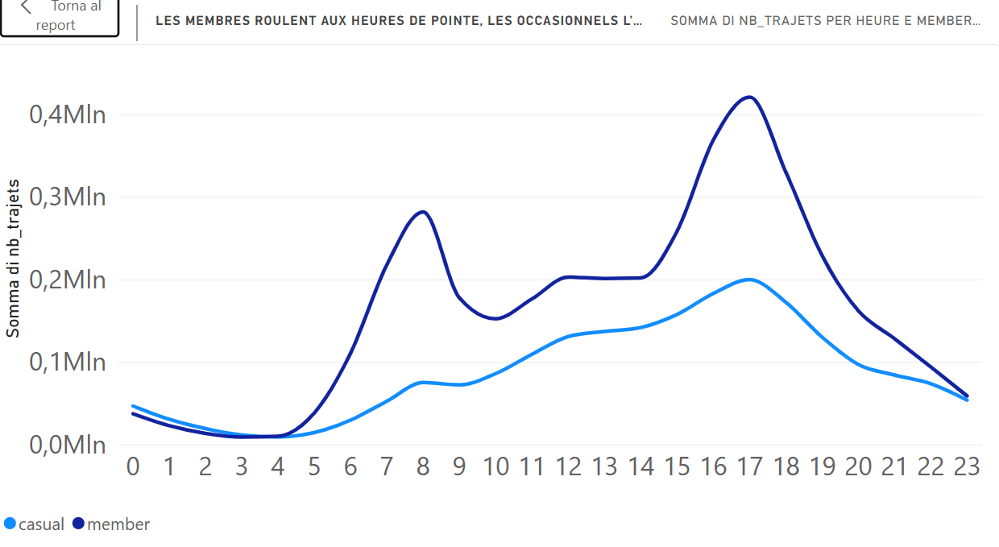
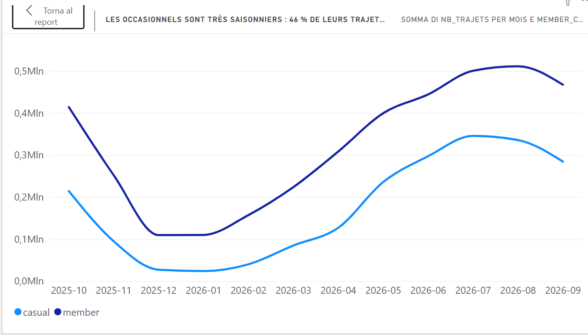
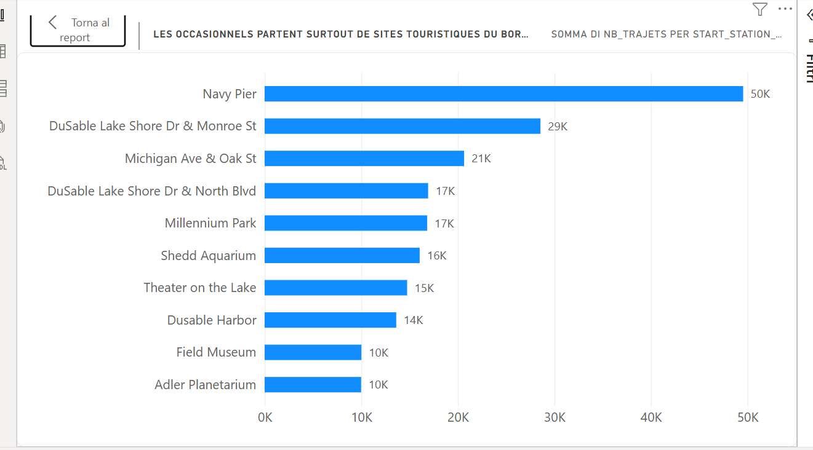

# Cyclistic : comment les membres et les occasionnels utilisent-ils les vélos différemment ?

Étude de cas d'analyse de données (Google Data Analytics Capstone, Case Study 1) sur 12 mois de trajets de vélos en libre-service à Chicago.

**Outils :** SQL (Google BigQuery) · Python · Power BI Desktop

## Contexte et question métier

Cyclistic est une entreprise fictive de vélos en libre-service. La directrice marketing souhaite convertir des cyclistes occasionnels (passe unique ou journée) en membres (abonnement annuel), plus rentables.

**Question analysée :** en quoi les membres et les occasionnels utilisent-ils les vélos différemment ?

## Données

- Source : données publiques de trajets Divvy (Motivate International Inc., licence d'utilisation publique), présentées comme données Cyclistic.
- Période : octobre 2025 à septembre 2026, 12 fichiers CSV mensuels.
- Volume : 6 171 785 trajets bruts, 13 colonnes (identifiant, type de vélo, début et fin, stations, coordonnées, type d'usager).
- Aucune donnée personnelle : impossible de connaître le motif du trajet ou le domicile.

Les CSV ne sont pas inclus dans ce dépôt (taille). Liens de téléchargement : https://divvy-tripdata.s3.amazonaws.com/index.html

## Méthode

1. **Chargement** dans BigQuery. Les fichiers de plus de 100 Mo ont été découpés en deux avec `python/decoupe.py` (limite du téléversement local).
2. **Assemblage** des 18 tables en `trips_all`, avec `ride_length_min` et `day_of_week`.
3. **Nettoyage** (voir tableau).
4. **Analyse** par dimension : volume, durée, jour, heure, mois, stations.
5. **Visualisation** dans Power BI à partir de 4 petites tables de synthèse.

### Journal de nettoyage

| Étape | Règle | Retirées | Restantes |
|---|---|---|---|
| Brut (`trips_all`) | - | - | 6 171 785 |
| Doublons exacts | `SELECT DISTINCT *` | 35 | 6 171 750 |
| Durées invalides | durée ≤ 0 ou dates manquantes | 2 002 | 6 169 748 |
| Faux départs | durée < 1 min | 157 219 | - |
| Durées extrêmes | durée > 24 h | 5 317 | **6 007 212** |

Au total 164 573 lignes retirées (2,7 %). Les seuils de 1 minute et de 24 heures sont des choix d'analyste.

## Résultats principaux

| Indicateur | Occasionnels | Membres |
|---|---|---|
| Trajets | 2 110 329 (35,1 %) | 3 896 883 (64,9 %) |
| Durée moyenne / médiane | 18,2 / 11,1 min | 12,2 / 8,7 min |
| Part des trajets le week-end | 37 % | 23 % |
| Part des trajets 7 h-8 h | 6,0 % | 12,8 % |
| Part des trajets en été (juin-août) | 46,4 % | 37,4 % |
| Part des trajets en hiver (déc.-févr.) | 4,3 % | 9,7 % |

- Les **membres** ont un profil régulier : deux pics en semaine (8 h et 17 h).
- Les **occasionnels** roulent plus longtemps, le week-end et l'après-midi, surtout de juin à août.
- Leurs stations de départ principales sont touristiques et situées au bord du lac : Navy Pier (49 559 trajets), DuSable Lake Shore Dr & Monroe St, Michigan Ave & Oak St, Millennium Park, Shedd Aquarium.






## Recommandations

1. **Offre de loisir** centrée sur le week-end et l'après-midi, plutôt que sur le domicile-travail.
2. **Campagne calée sur la saison** : lancement en mars ou avril, intensité maximale jusqu'en septembre.
3. **Actions aux stations touristiques du bord du lac** (affichage, QR codes) et publicité numérique géolocalisée.

## Limites

- Les données décrivent des comportements, pas leurs causes : « loisir » et « domicile-travail » sont des hypothèses.
- Une seule année de données.
- Environ 28 % des trajets en vélo électrique n'ont pas de station de départ ; le classement des stations les exclut.
- Hypothèses non vérifiées : les heures sont en heure locale de Chicago ; 58 trajets de septembre 2025 sont présents dans le fichier d'octobre et exclus de la table mensuelle.
- Les 35 doublons sont déduits par calcul (lignes distinctes = identifiants uniques), sans examen direct des paires.
- La médiane est approximative (`APPROX_QUANTILES`).

## Structure du dépôt

```
cyclistic-case-study/
├── README.md
├── sql/            requêtes de nettoyage, d'analyse et de synthèse
├── python/         decoupe.py (découpage des gros CSV)
├── docs/           documentation complète (PDF)
└── visuals/        captures des graphiques Power BI
```

## Requêtes clés

```sql
-- Assemblage des tables mensuelles (à lancer une seule fois)
CREATE OR REPLACE TABLE `PROJET.cyclistic.trips_all` AS
SELECT *,
  TIMESTAMP_DIFF(ended_at, started_at, SECOND) / 60 AS ride_length_min,
  EXTRACT(DAYOFWEEK FROM started_at) AS day_of_week
FROM `PROJET.cyclistic.trips_*`;

-- Suppression des doublons et des durées invalides
CREATE OR REPLACE TABLE `PROJET.cyclistic.trips_clean` AS
SELECT DISTINCT * FROM `PROJET.cyclistic.trips_all`
WHERE started_at IS NOT NULL AND ended_at IS NOT NULL AND ride_length_min > 0;

-- Table d'analyse : trajets de 1 min à 24 h
CREATE OR REPLACE TABLE `PROJET.cyclistic.analysis_trips` AS
SELECT * FROM `PROJET.cyclistic.trips_clean`
WHERE ride_length_min >= 1 AND ride_length_min <= 1440;
```

## Auteur

Adji Dior GUEYE .  linkdin : [https://www.linkedin.com/in/adji-dior-gueye-1880461b6/?lipi=urn%3Ali%3Apage%3Ad_flagship3_profile_view_base_contact_details%3BeyMQcb%2FWR9eW%2B4Ry2hA2Vw%3D%3D]